# Projeto de Interface

## User Flow

A interface do Medzo foi criada para ser intuitiva e eficiente na marcação de consultas online. Cada tela será desenvolvida para garantir usabilidade, clareza e acessibilidade, atendendo às necessidades dos usuários de forma organizada e prática.

O fluxograma apresentado na figura 4 mostra o fluxo de interação do usuário pelas telas do sistema. Cada uma das telas deste fluxo é detalhada na seção de Protótipo de alta fidelidade que se segue. Para visualizar o protótipo interativo,  acesse o <a href="https://miro.com/welcomeonboard/cW5sejZaQ1hZR3RsanBXajI0Z3RqQlltN0pJc2lqWXFSUjRZWSs1MVIvUjFON3RQVlhESHNwZEo5a1pyamc1c1lteFJhN0lsc3d0QWMzcjl3cy8wTTlEZjhPK3cvekk4SCtQKzJxdGNCZkxJdzhXNUxteEVrc3U3RHY0SWp2SGZ3VHhHVHd5UWtSM1BidUtUYmxycDRnPT0hdjE=?share_link_id=207637701563">fluxograma no miro</a>.

<figure> 
    <figcaption>Figura 4 - Fluxograma
</figure> 

## Protótipo

Desenvolver um protótipo emerge como uma das maneiras mais ágeis e econômicas de validar uma ideia, conceito ou funcionalidade. Isso permite a interação, avaliação, modificação e aprovação das principais características de uma interface antes de entrar na fase de desenvolvimento. Leia o artigo [Protótipos: baixa, média ou alta fidelidade?](https://medium.com/ladies-that-ux-br/prot%C3%B3tipos-baixa-m%C3%A9dia-ou-alta-fidelidade-71d897559135).

## Tela Login 
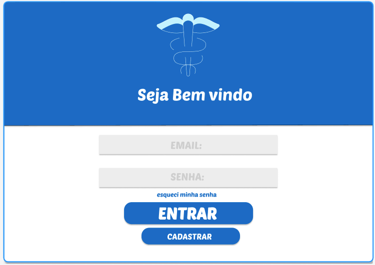

Nesta página, o usuário deve inserir seu e-mail e senha cadastrados para acessar o sistema. Caso tenha esquecido a senha, pode clicar em "esqueci minha senha" para recuperá-la. Novos usuários devem clicar em "CADASTRAR" para iniciar.

## Tela Seleção de Cadastro 

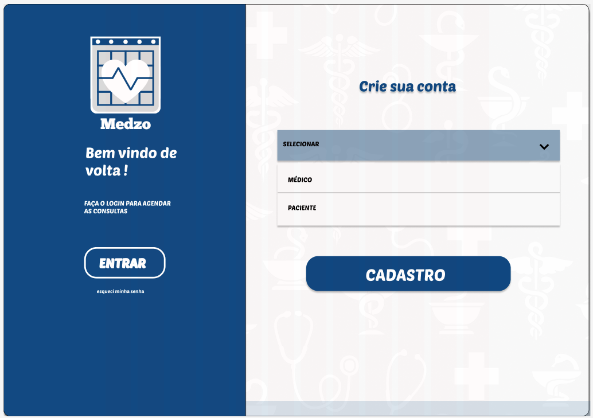

Esta é a primeira etapa do cadastro. O novo usuário deve selecionar o tipo de perfil que deseja criar: "Médico" ou "Paciente". A escolha direcionará para o formulário de cadastro correspondente.Esta é a primeira etapa do cadastro. O novo usuário deve selecionar o tipo de perfil que deseja criar: "Médico" ou "Paciente". A escolha direcionará para o formulário de cadastro correspondente.

## Tela Cadastro Médico 

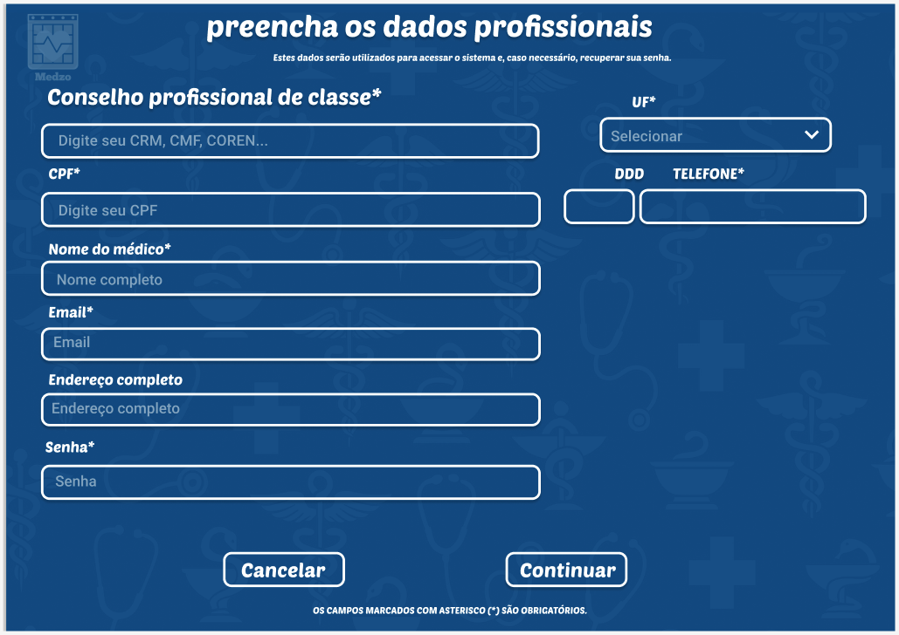

Este formulário é destinado ao cadastro de profissionais de saúde. O usuário deve informar seu conselho profissional (CRM, CRF, COREN), CPF, nome completo e outros dados para se registrar na plataforma como médico ou especialista.

## Tela Cadastro Paciente

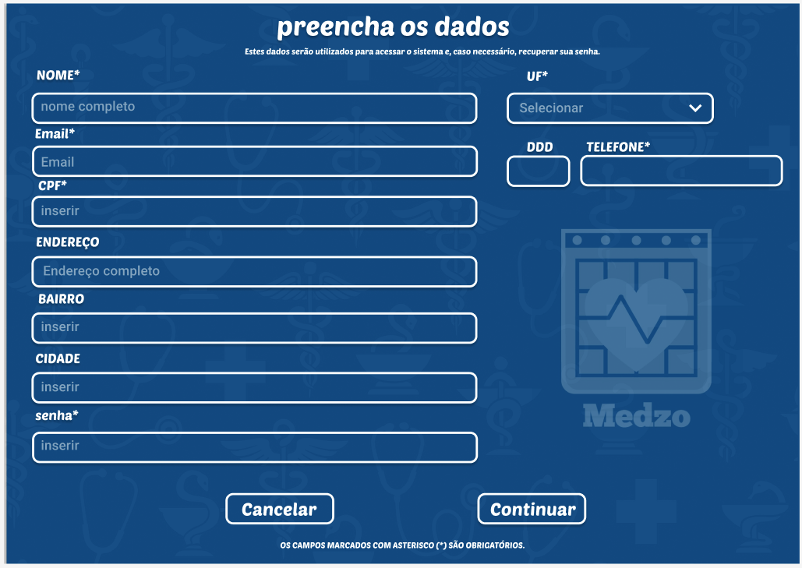

Nesta tela, o paciente deve preencher seus dados pessoais para criar uma conta. Campos como nome completo, filiação, endereço, CPF e telefone são necessários para completar o cadastro e acessar as funcionalidades do sistema

## Tela Menu Principal 
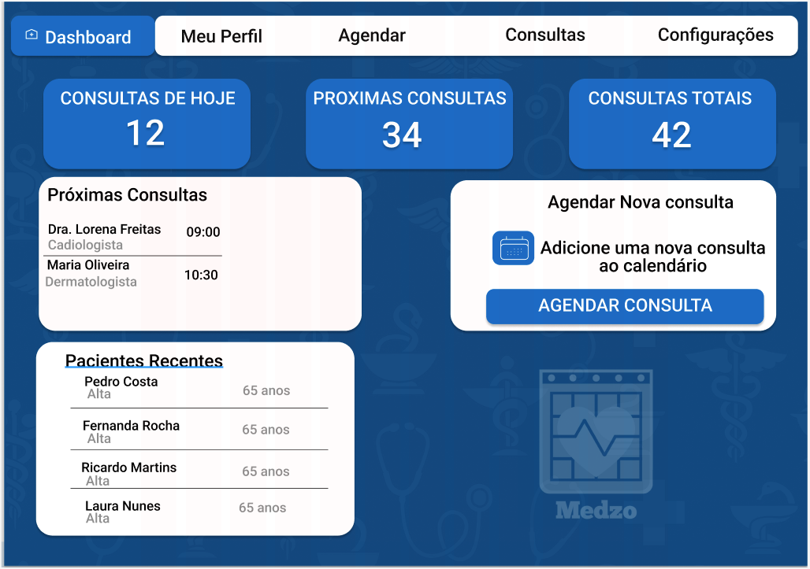

Esta é a tela inicial após o login. Ela oferece um resumo geral da atividade do profissional, com o número de consultas do dia, próximas consultas e o total. Também exibe os pacientes recentes e um atalho para "Agendar Nova Consulta"

## Tela Menu de busca

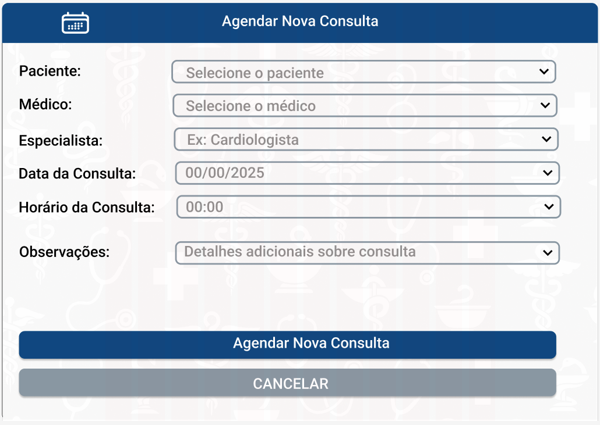

Esta página funciona como uma ferramenta de pesquisa para localizar consultas específicas. O usuário pode realizar uma busca rápida digitando o nome do paciente ou do médico na barra principal. Para resultados mais precisos, a tela oferece filtros detalhados por "Especialidade", "Data da Consulta" e "Status" (Agendada, Concluída, Cancelada). A lista de resultados exibe todas as consultas que correspondem aos critérios da pesquisa.

## Tela perfil publico do medico

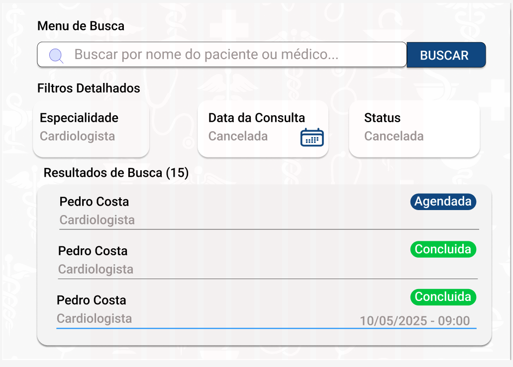
 Esta página exibe as informações públicas do profissional para que os pacientes possam conhecê-lo melhor antes de agendar. A tela apresenta a foto do médico, seu nome completo, especialidade(s) e número de registro (CRM). Inclui também uma biografia profissional, as qualificações e as avaliações de outros pacientes. Ao final, o endereço da clínica é exibido e o paciente pode clicar no botão "Agendar Consulta" para marcar um horário diretamente.

## Tela agenda consulta paciente 

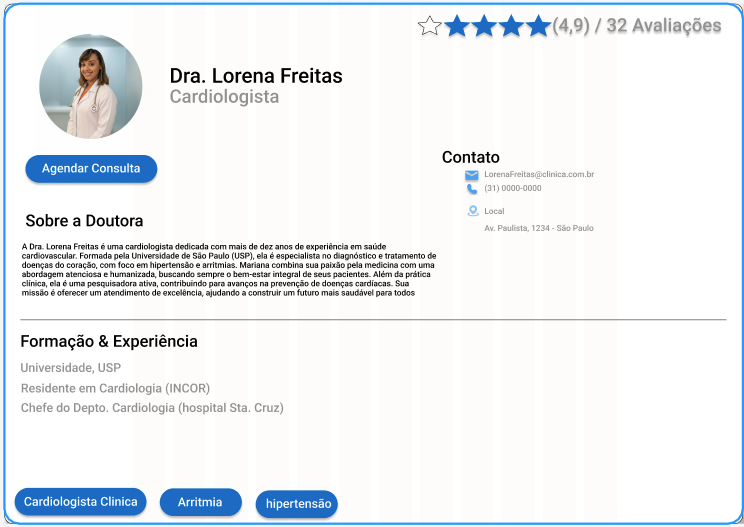

Esta tela guia o paciente pelo processo de marcação de uma nova consulta. Primeiramente, ele deve selecionar a [especialidade desejada] e, em seguida, [escolher o profissional]. A tela então exibe a agenda do médico com os dias e horários disponíveis para que o paciente possa selecionar a melhor opção e confirmar o agendamento.

## Tela consultas

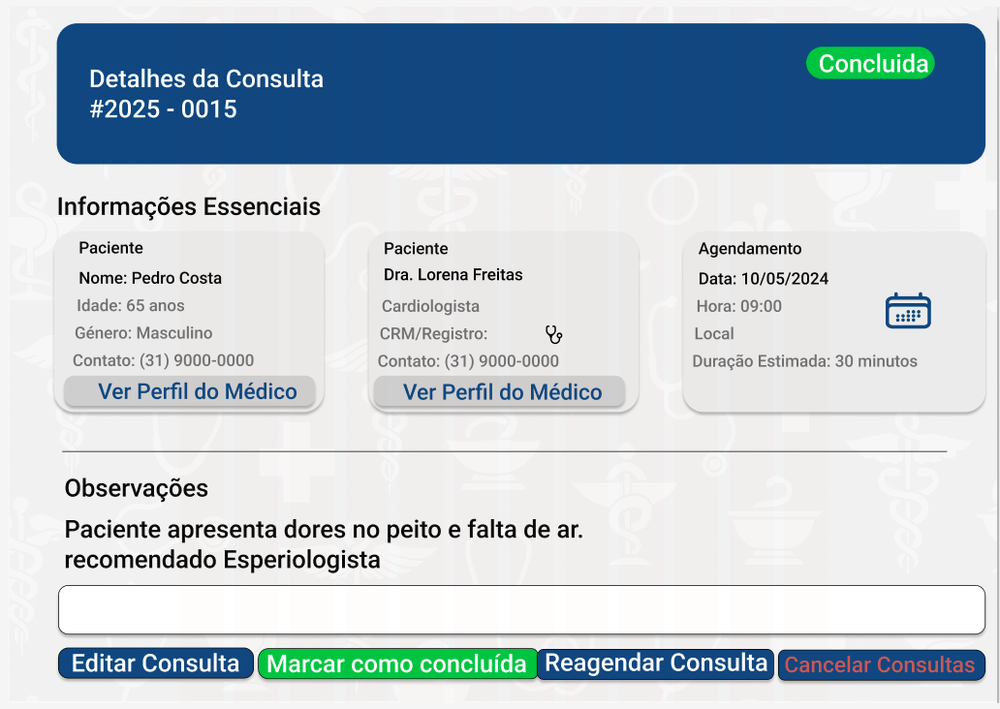
Nesta área, o paciente tem acesso ao seu histórico completo de agendamentos. A tela é dividida entre "Próximas Consultas" e "Consultas Realizadas", permitindo que ele visualize os detalhes de cada atendimento, como data, hora e o médico responsável. A partir daqui, o paciente também tem a opção de [cancelar ou obter mais informações sobre um agendamento futuro].

## Tela perfil paciente

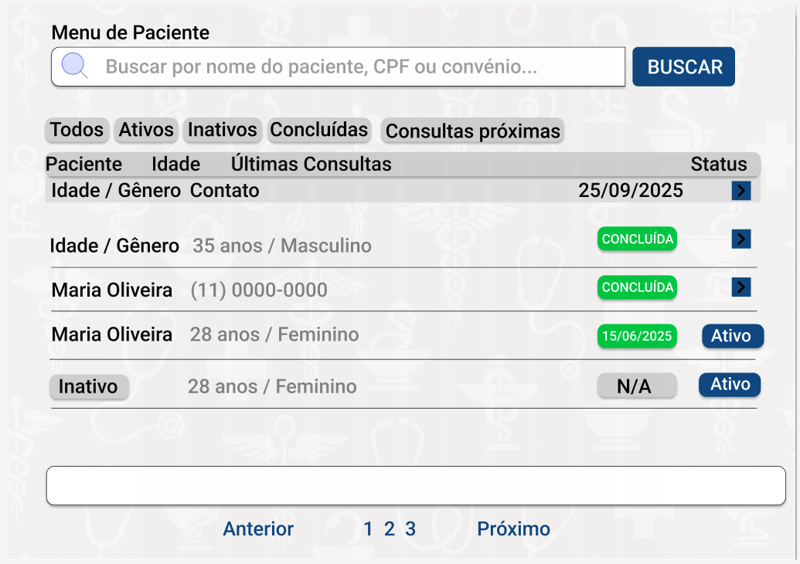

Nesta tela, o paciente pode visualizar e gerenciar todas as suas informações cadastrais. A página é dividida em seções como "Dados Pessoais" (nome completo, CPF, data de nascimento), "Informações de Contato" (telefone, e-mail) e "Endereço". O paciente tem a autonomia para atualizar seus dados clicando no botão "Editar Informações". A tela também pode oferecer opções de segurança, como "Alterar Senha".

## Tela minha agenda
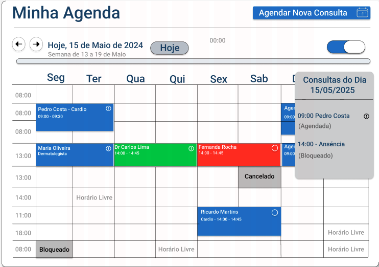

Esta é a principal ferramenta de visualização e gerenciamento de horários do profissional. Apresentada em formato de calendário semanal, a tela exibe todos os dias e horários de trabalho, permitindo uma visão clara da rotina. Cada bloco de horário é identificado por cores que representam o status: horários já agendados (mostrando o nome do paciente), horários livres, e períodos bloqueados. O profissional pode navegar entre as semanas e os dias, e ao clicar em uma consulta, pode ver seus detalhes. A tela também possui o botão principal "Agendar Nova Consulta" para adicionar um novo evento diretamente no calendário.

## Tela configurações de agenda

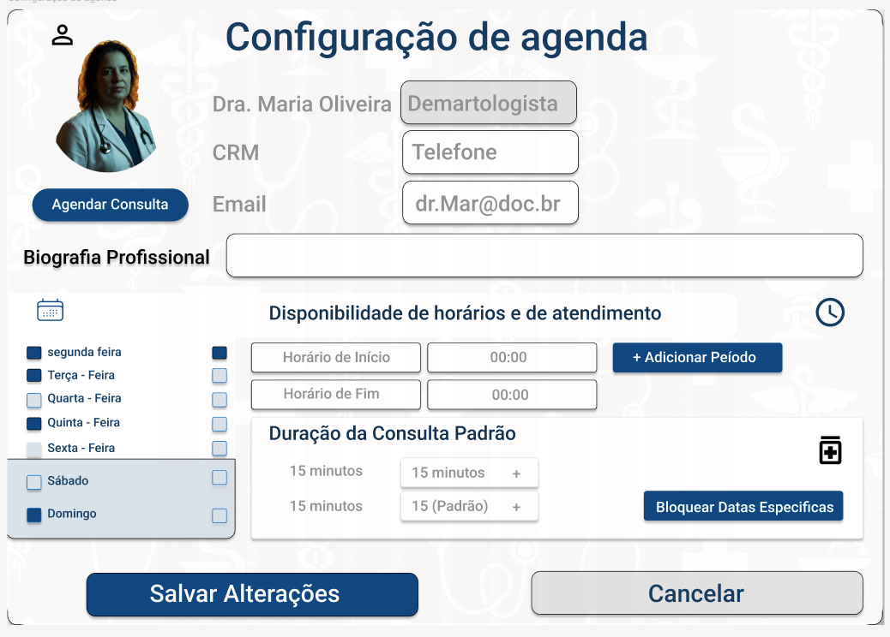

 Nesta tela, o profissional de saúde personaliza completamente seu perfil e sua disponibilidade para consultas. É possível editar informações como foto, biografia e dados de contato. A principal funcionalidade é a definição dos horários de atendimento: o profissional seleciona os dias da semana em que trabalha e define um ou mais períodos para cada dia, com horário de início e fim. Adicionalmente, ele pode configurar a "Duração da Consulta Padrão" e usar a opção "Bloquear Datas Específicas" para impedir agendamentos em feriados ou férias. Todas as mudanças são aplicadas ao clicar em "Salvar Alterações".

### Protótipo de baixa fidelidade

Protótipos de baixa fidelidade apresentam de forma simplificada o design da interface e o relacionamento entre suas páginas, permitindo evolução da proposta da solução. Neste projeto, os utilizaremos para apoiar a validação dos requisitos e efetuar mudanças dos mesmos, caso seja necessário, para menor impacto na codificação da aplicação.

[Elabore as principais interfaces gráficas da aplicação de modo que os requisitos funcionais sejam contemplados nas telas propostas.]

[Adicione aqui as telas da sua aplicação com seus devidos títulos.] 
 
> **Links Úteis**:
> - [Protótipos vs Wireframes](https://www.nngroup.com/videos/prototypes-vs-wireframes-ux-projects/)
>- Ferramentas:
>> - [Pencil](https://pencil.evolus.vn/)
>> - [MarvelApp](https://marvelapp.com/)
>> - [Figma](https://www.figma.com/)

