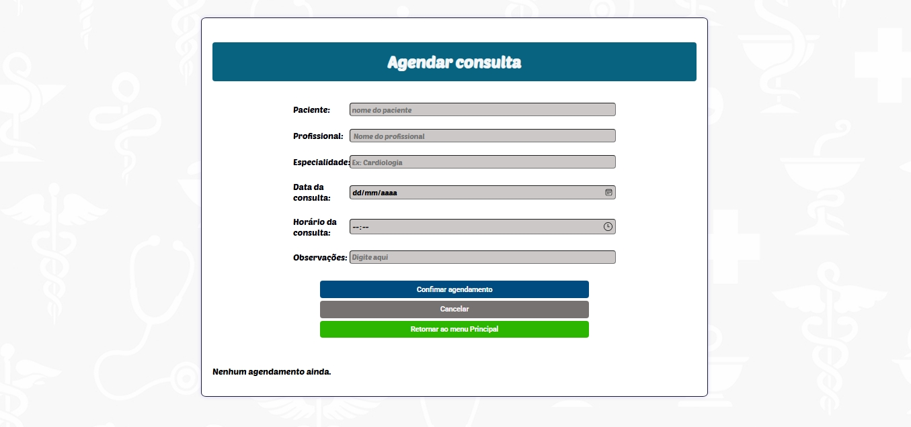

# Programação de Funcionalidades

Pré-requisitos: <a href="https://github.com/ICEI-PUC-Minas-PMV-ADS/pmv-ads-2025-2-e1-proj-web-t9-g5-turma-9/blob/main/documentos/02-Especifica%C3%A7%C3%A3o%20do%20Projeto.md"> Especificação do Projeto</a>, <a href="https://github.com/ICEI-PUC-Minas-PMV-ADS/pmv-ads-2025-2-e1-proj-web-t9-g5-turma-9/blob/main/documentos/03-Metodologia.md"> Metodologia</a>, <a href="https://github.com/ICEI-PUC-Minas-PMV-ADS/pmv-ads-2025-2-e1-proj-web-t9-g5-turma-9/blob/main/documentos/04-Projeto%20de%20Interface.md"> Projeto de Interface</a>. 

### Tela de Login (RF-001) 
Responsável: Ozias

Exemplo da tela de login:

#### Requisito atendido

RF-001	A aplicação deve permitir que o paciente e profissional da saúde façam login.

#### Artefatos da funcionalidade

●tela_login.html

●style_login.css

●script_login.js

#### Instruções de acesso

Passo 1: Abra um navegador de Internet e informe a seguinte URL https://icei-puc-minas-pmv-ads.github.io/pmv-ads-2025-2-e1-proj-web-t9-g5-turma-9/codigo-fonte/tela-de-login-ozias/tela_login.html

### Tela de Seleção de Cadastro (RF-002) 
Responsável: Ozias

Exemplo da tela de login:

#### Requisito atendido

RF-01	A aplicação deve permitir cadastro de conta do paciente e profissional da saúde.

#### Artefatos da funcionalidade

●Tela_de_cadastro.html

●Tela_de_cadastro.css

●Tela_de_cadastro.js

#### Instruções de acesso

Passo 1: Abra um navegador de Internet e informe a seguinte URL https://icei-puc-minas-pmv-ads.github.io/pmv-ads-2025-2-e1-proj-web-t9-g5-turma-9/codigo-fonte/tela-de-login-ozias/tela_login.html

Passo 2. Clique no botão "Cadastrar" da tela de login 

### Tela de Cadastro Médico (RF-003) 
Responsável: Andryws

Exemplo da tela de Cadastro Médico:

#### Requisito atendido

RF-01	A aplicação deve permitir cadastro de conta do paciente e profissional da saúde.

#### Artefatos da funcionalidade

●cadastro_medico.html

●cadastro_medico.css

●script.js

#### Instruções de acesso

Passo 1: Abra um navegador de Internet e informe a seguinte URL https://icei-puc-minas-pmv-ads.github.io/pmv-ads-2025-2-e1-proj-web-t9-g5-turma-9/codigo-fonte/tela-de-login-ozias/tela_login.html

Passo 2: Clique no botão "Cadastrar" da tela de login.

Passo 3: selecione a opção "médico" da tela de seleção de cadastro e clique em "cadastrar"

### Tela da Cadastro Paciente (RF-004) 
Responsável: Sérvulo

Exemplo da tela de Cadastro Paciente:

#### Requisito atendido

RF-01	A aplicação deve permitir cadastro de conta do paciente e profissional da saúde.

#### Artefatos da funcionalidade

●index.html

●style.css

●script.js

#### Instruções de acesso

Passo 1: Abra um navegador de Internet e informe a seguinte URL https://icei-puc-minas-pmv-ads.github.io/pmv-ads-2025-2-e1-proj-web-t9-g5-turma-9/codigo-fonte/tela-de-login-ozias/tela_login.html

Passo 2: Clique no botão "Cadastrar" da tela de login.

Passo 3: selecione a opção "paciente" da tela de seleção de cadastro e clique em "cadastrar"

### tela do Menu Paciente (RF-005)
Resposavel: Gustavo

Exemplo da tela do Menu Paciente: 

#### Requisito atendido

#### Artefatos da funcionalidade

●MenuPaciente.html

●MenuPaciente.css

●MenuPaciente.js

#### Instruções de acesso

Passo 1: Abra um navegador de Internet e informe a seguinte URL https://icei-puc-minas-pmv-ads.github.io/pmv-ads-2025-2-e1-proj-web-t9-g5-turma-9/codigo-fonte/tela-de-login-ozias/tela_login.html

Passo 2: Coloque os seu email e senha de paciente nos campos da tela de login 

Passo 3: Clique no botão "entrar" da tela de login.

### tela do Menu Profissional (RF-005)
Resposavel: Gustavo

Exemplo da tela do Menu Profissional: 

#### Requisito atendido

#### Artefatos da funcionalidade

●MenuProfissional.html

●MenuProfissional.css

●MenuProfissional.js

#### Instruções de acesso

Passo 1: Abra um navegador de Internet e informe a seguinte URL https://icei-puc-minas-pmv-ads.github.io/pmv-ads-2025-2-e1-proj-web-t9-g5-turma-9/codigo-fonte/tela-de-login-ozias/tela_login.html

Passo 2: Coloque os seu email e senha de profissional nos campos da tela de login 

Passo 3: Clique no botão "entrar" da tela de login.

### Tela do Menu de Busca (RF-006) 
Responsável: Ozias

Exemplo da tela do Menu de Busca:

#### Requisito atendido

RF-04	A aplicação deve permitir a funcionalidade de busca e filtro de pesquisa.

#### Artefatos da funcionalidade

●menubusca.html

●script.css

●style.js

#### Instruções de acesso

Passo 1: Abra um navegador de Internet e informe a seguinte URL: https://icei-puc-minas-pmv-ads.github.io/pmv-ads-2025-2-e1-proj-web-t9-g5-turma-9/codigo-fonte/tela-de-login-ozias/tela_login.html

Passo 2: Coloque os seu email e senha de paciente nos campos da tela de login

Passo 3: Clique no botão "entrar" da tela de login.

Passo 4: Selecione o botão "busca" na tela de Menu de paciente 

### tela de Agenda (RF-007)
Resposavel: Ozias

Exemplo da tela de Agenda: 

#### Requisito atendido

RF-06	A aplicação deve permitir acesso a agenda.

#### Artefatos da funcionalidade

●agenda.html

●agenda.css

●agenda.js

#### Instruções de acesso

Abra um navegador de Internet e informe a seguinte URL https://icei-puc-minas-pmv-ads.github.io/pmv-ads-2025-2-e1-proj-web-t9-g5-turma-9/codigo-fonte/tela-de-login-ozias/tela_login.html

Passo 2: Coloque os seu email e senha de profissional nos campos da tela de login

Passo 3: Clique no botão "entrar" da tela de login.

Passo 4: Selecione o botão "agenda" na tela de Menu de profissional

### tela de Agendamento de Consulta (RF-008)
Resposavel: Lorena

Exemplo da tela de Agenda: 

#### Requisito atendido

RF-03	A aplicação deve permitir marcação de consulta online.

#### Artefatos da funcionalidade

●telaagendamento.html

●telaagendamento.css

●telaagendamento.js

#### Instruções de acesso
Passo1: Abra um navegador de Internet e informe a seguinte URL https://icei-puc-minas-pmv-ads.github.io/pmv-ads-2025-2-e1-proj-web-t9-g5-turma-9/codigo-fonte/tela-de-login-ozias/tela_login.html

Passo 2: Coloque os seu email e senha de paciente nos campos da tela de login

Passo 3: Clique no botão "entrar" da tela de login.

Passo 4: Localize e clique o botão "Agendar consulta" na tela de menu de paciente 

Passo 5: preencha os dados solicitados

### Tela de Recuperação de Senha (RF-009) 
Responsável: Ozias

Exemplo da tela de Recuperação de Senha:

#### Requisito atendido

#### Artefatos da funcionalidade

●esquecisenha.html

●esquecisenha.css

●esquecisenha.js

#### Instruções de acesso

Passo 1: Abra um navegador de Internet e informe a seguinte URL: https://icei-puc-minas-pmv-ads.github.io/pmv-ads-2025-2-e1-proj-web-t9-g5-turma-9/codigo-fonte/tela-de-login-ozias/tela_login.html

Passo 2: Clique no botão "Esqueci a senha" na tela de login

### Tela de Recuperação de Usuario (RF-010) 
Responsável: Ozias

Exemplo da tela de Recuperação de Usuario:

#### Requisito atendido

#### Artefatos da funcionalidade

●esqueciusuario.html

●esqueciusuario.css

●esqueciusuario.js

#### Instruções de acesso

Passo 1: Abra um navegador de Internet e informe a seguinte URL: https://icei-puc-minas-pmv-ads.github.io/pmv-ads-2025-2-e1-proj-web-t9-g5-turma-9/codigo-fonte/tela-de-login-ozias/tela_login.html

Passo 2: Clique no botão "Esqueci o usuario" na tela de login

### Tela de Consultas (RF-011) 
Responsável: Gustavo

Exemplo da tela de Consultas:

#### Requisito atendido

RF-07	A aplicação deve permitir acesso ao histórico de consultas.
RF-08	A aplicação deve permitir cancelar consulta.
RF-09	A aplicação deve permitir notificações de consulta.

#### Artefatos da funcionalidade

●Consultas.html

●Consultas.css

●Consultas.js

#### Instruções de acesso

Passo 1: Abra um navegador de Internet e informe a seguinte URL https://icei-puc-minas-pmv-ads.github.io/pmv-ads-2025-2-e1-proj-web-t9-g5-turma-9/codigo-fonte/tela-de-login-ozias/tela_login.html

Passo 2: Coloque os seu email e senha nos campos da tela de login 

Passo 3: Clique no botão "entrar" da tela de login.

Passo 4: Clique em "Consultas" no menu.

## Exemplo para próximas páginas 

### Tela de XXXXXX (RF-XXX) 
Responsável: XXXXX

Exemplo da tela de XXXXXX:

IMAGEM DA TELA

#### Requisito atendido

(se tiver)

#### Artefatos da funcionalidade

●xxxxxx.html

●xxxx.css

●xxxxx.js

#### Instruções de acesso

Abra um navegador de Internet e informe a seguinte URL: https://icei-puc-minas-pmv-ads.github.io/pmv-ads-2025-2-e1-proj-web-t9-g5-turma-9/codigo-fonte/tela-de-login-ozias/tela_login.html
passo 2
passo 3 
passo 4

Links Úteis :

Trabalhando com armazenamento local HTML5 e JSON
Tutorial JSON
JSON - Introdução (W3Schools)
Tutorial JSON (TutorialsPoint)

> **Links Úteis**:
> - [Trabalhando com HTML5 Local Storage e JSON](https://www.devmedia.com.br/trabalhando-com-html5-local-storage-e-json/29045)
> - [JSON Tutorial](https://www.w3resource.com/JSON)
> - [JSON - Introduction (W3Schools)](https://www.w3schools.com/js/js_json_intro.asp)
> - [JSON Tutorial (TutorialsPoint)](https://www.tutorialspoint.com/json/index.htm)

