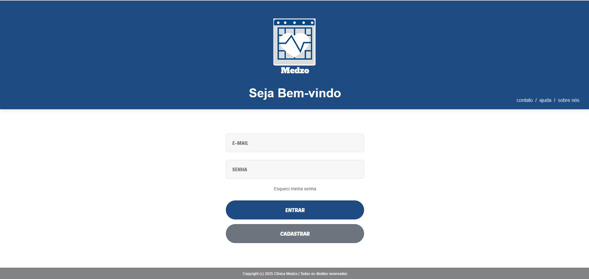
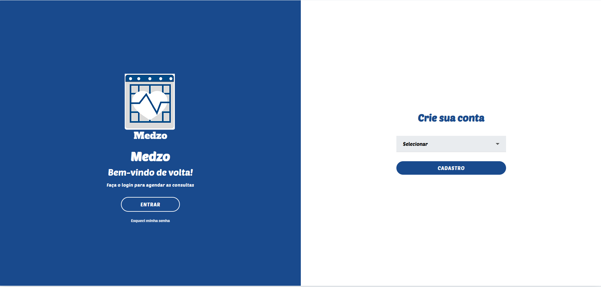

## Título da funcionalidade

Pré-requisitos: <a href="https://github.com/ICEI-PUC-Minas-PMV-ADS/pmv-ads-2025-2-e1-proj-web-t9-g5-turma-9/blob/main/documentos/02-Especifica%C3%A7%C3%A3o%20do%20Projeto.md"> Especificação do Projeto</a>, <a href="https://github.com/ICEI-PUC-Minas-PMV-ADS/pmv-ads-2025-2-e1-proj-web-t9-g5-turma-9/blob/main/documentos/03-Metodologia.md"> Metodologia</a>, <a href="https://github.com/ICEI-PUC-Minas-PMV-ADS/pmv-ads-2025-2-e1-proj-web-t9-g5-turma-9/blob/main/documentos/04-Projeto%20de%20Interface.md"> Projeto de Interface</a>. 

Tela de Login (RF-001)Responsável: Ozias

Exemplo da tela de login

## Requisito atendido
O acesso a tela de cadastro poderá ser feito através da opção de menu “Cadastrar”. 

## Instruções de acesso

## APRESENTAÇÃO E NAVEGAÇÃO
A plataforma Medzo é um sistema para a área da saúde, acessível via navegador.
A tela de login, com design azul, pede e-mail e senha para acesso.
A interface é intuitiva, oferecendo opções para entrar, cadastrar ou recuperar a senha.
A navegação secundária inclui links para "contato", "ajuda" e "sobre nós".

3. TECNOLOGIAS UTILIZADAS
As estruturas de dados foram desenvolvidas com base em linguagens de marcação e de programação, a saber:
HTML 
CSS 
JS 

O sistema é acessado através de um navegador de internet, utilizando a URL especificada para navegação.
A tela principal do sistema oferece as opções de navegação "contato", "ajuda" e "sobre nós".
Nessa mesma interface, encontra-se a opção para cadastro. Ao selecionar a opção "cadastrar", o usuário é direcionado para a página de registro, onde é possível escolher entre os perfis de médico ou paciente.
Após a conclusão do cadastro, o usuário pode acessar sua conta. O sistema também disponibiliza a funcionalidade de recuperação de senha por meio da opção "esqueci a senha".

## **Título da funcionalidade**
Tela de Cadastro (RF-002) Responsável: Ozias
RF-002: O site deve permitir ao usuário cadastrar uma conta

##**Exemplo da tela de cadastro**

## Requisito atendido
O acesso ao formulário de cadastro é realizado a partir da tela de login, por meio da opção "Cadastrar".
Ao selecionar essa opção, o usuário é direcionado para uma página de escolha, onde deve selecionar o perfil correspondente à sua necessidade: médico ou paciente.
A escolha do perfil redireciona o usuário para a página específica de registro, que pode ser o formulário de cadastro de médico ou o de cadastro de paciente.

## Instruções de acesso

## **APRESENTAÇÃO E NAVEGAÇÃO**
## **Instruções para a Tela de Cadastro e Acesso**
A interface do sistema é composta por duas seções distintas, conforme a funcionalidade desejada pelo usuário:
## **Acesso à Conta Existente**

Na seção da esquerda, é disponibilizada a área de login para usuários já cadastrados na plataforma **Medzo**. O texto "Bem-vindo de volta!" e a opção **"ENTRAR"** direcionam o usuário ao acesso de sua conta. Caso o usuário não se recorde de sua senha, a funcionalidade **"Esqueci minha senha"** permite a recuperação dos dados de acesso. O Botão "ENTRAR" retorna para tela de login. 

## **Criação de Nova Conta**

A seção da direita é destinada à criação de novas contas. Para dar continuidade ao processo, o usuário deve:
1.  Selecionar o perfil desejado no menu suspenso, optando entre **"médico"** ou **"paciente"**.
2.  Clicar no botão **"CADASTRO"** para ser redirecionado à página específica de registro, onde deverá fornecer as informações necessárias para a criação da nova conta.

3. TECNOLOGIAS UTILIZADAS
As estruturas de dados foram desenvolvidas com base em linguagens de marcação e de programação, a saber:
HTML 
CSS 
JS 

O sistema é acessado através de um navegador de internet, utilizando a URL especificada para navegação.
A tela principal do sistema oferece as opções de navegação "contato", "ajuda" e "sobre nós".
Nessa mesma interface, encontra-se a opção para cadastro. Ao selecionar a opção "cadastrar", o usuário é direcionado para a página de registro, onde é possível escolher entre os perfis de médico ou paciente.
Após a conclusão do cadastro, o usuário pode acessar sua conta. O sistema também disponibiliza a funcionalidade de recuperação de senha por meio da opção "esqueci a senha".

### Tela de Cadastro de pacientes (RF-001)

Responsável: Sérvulo

O acesso a tela de cadastro poderá ser feito através da opção de menu “Cadastre-se”. As estruturas de dados foram baseadas em HTML, CSS e JS.

Exemplo da tela de cadastro: 

_______________________________________________________________________________________
Programação de Funcionalidades
Implementação da aplicação descrita por meio dos requisitos codificados.

[Utilize a estrutura abaixo para cada funcionalidade entregue na etapa]

Título da funcionalidade
[Adicionar imagem da funcionalidade/tela]

Requisito atendido
[RF-X: acréscimo à descrição do requisito atendido]

Artefatos da funcionalidade
[Adicione os nomes dos arquivos relacionados ao desenvolvimento da funcionalidade]

Estrutura de Dados
[Caso existe estrutura de dados, adicione aqui]

Instruções de acesso
[Adicione as orientações de acesso à funcionalidade]

Responsável
[Adição do nome do responsável pelo desenvolvimento da funcionalidade]

Links Úteis :

Trabalhando com armazenamento local HTML5 e JSON
Tutorial JSON
JSON - Introdução (W3Schools)
Tutorial JSON (TutorialsPoint)

> **Links Úteis**:
> - [Trabalhando com HTML5 Local Storage e JSON](https://www.devmedia.com.br/trabalhando-com-html5-local-storage-e-json/29045)
> - [JSON Tutorial](https://www.w3resource.com/JSON)
> - [JSON - Introduction (W3Schools)](https://www.w3schools.com/js/js_json_intro.asp)
> - [JSON Tutorial (TutorialsPoint)](https://www.tutorialspoint.com/json/index.htm)

